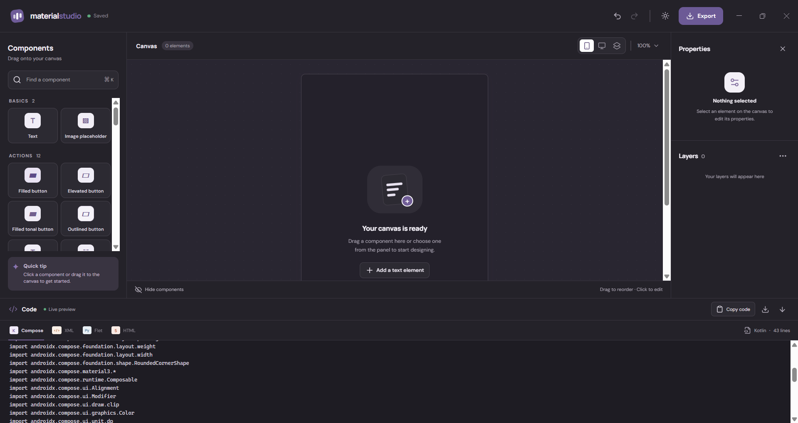

# Material Layout Studio

Material Layout Studio is a desktop visual editor for arranging Material 3 components and exporting the same layout as Jetpack Compose, Android XML, Flet, or standalone HTML. Canvas previews use Google's Material Web components where available, with those primitives composed for pickers and other patterns the library does not provide.



## Run locally

```bash
npm install --ignore-scripts
npm run dev
```

In a second PowerShell window, compile the Electron entry point and open it with your existing Electron executable:

```powershell
npx tsc -p tsconfig.electron.json
& "C:\path\to\electron.exe" .
```

To create a Windows installer using an existing Electron distribution, first run `npm run build:web` and `npx tsc -p tsconfig.electron.json`, then run `npx electron-builder --win nsis --x64 --config.electronDist="C:\path\to\electron\dist" --config.electronVersion=<version> --config.win.signAndEditExecutable=false`. Replace the paths and version with your installed Electron values. The installer uses ASAR, maximum compression, and only the English locale.

## Editing

- Add components by clicking an item in the left palette or dragging it onto the canvas.
- Browse the action, selection and input, navigation, containment, communication and feedback, and XR component groups. Component previews use Material Web custom elements; the wavy progress preview uses SVG because Material Web does not provide that variant.
- Select an element to edit its label, dimensions, full-width/full-height sizing, canvas position, color, text size, radius, and toggle state. Position presets include flow layout and a 3x3 set of canvas anchors. Reorder elements by dragging them on the canvas or use the layer controls. Use the top-bar theme button to switch the entire app between light and dark mode.
- Choose circular or wavy progress indicators separately from the Communication & Feedback palette.
- Use the device buttons and zoom control to adjust the canvas preview. The current design is saved in local storage.
- Export code is generated from the same ordered component model and updates as you edit. Copy it or download the selected format.

## Export notes

Compose exports a `MaterialLayout` composable built around Material 3 `Scaffold`, `Column`, `Row`, and `Box` layouts; add the Jetpack Compose Material 3 dependency to the Android project. A flow-positioned app bar is emitted through `Scaffold.topBar`. Flet exports a Python page using `ft.run`; a flow-positioned app bar is assigned to `page.appbar`, and other components are placed in a column or positioned stack. Flet exports use the selected device size and light/dark theme, and collect repeated colors into a `COLORS` dictionary. XML exports a layout resource using Android views and Material Components widgets; include the Material Components dependency and use a Material 3-compatible theme. HTML exports a standalone document with its styles included.

Compose and Flet exports cover the components currently available in the editor palette. Controls without a direct counterpart in a target framework are composed from that framework's Material controls; their layout and appearance can therefore differ slightly from the browser preview.

The Windows app uses a native title-bar overlay to retain the standard window controls. Electron’s Chromium runtime dominates installed disk and memory use; ASAR and compression reduce distributable size, but cannot remove that runtime cost.
